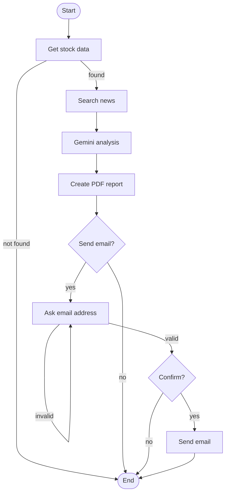

# TradeLens – AI-Powered Stock Research and Email Automation Agent

## About the Project
TradeLens is a Python project that runs in the terminal. I type a stock symbol, and it collects stock data and recent news. Then it asks Gemini to analyze them and makes a simple PDF report. If I want, I can email the report to someone.

I used LangGraph to connect all the steps into one workflow. I made this project to practice Python basics, working with APIs, and building a step-by-step workflow.

## Features
- Asks for a stock symbol (for example `AAPL` or `RELIANCE.NS`)
- Fetches basic stock data: price, 52-week high and low, PE ratio, market cap
- Searches for recent financial news
- Uses Gemini to write a short analysis
- Creates a PDF report
- Uses LangGraph to run every step as a workflow
- Asks if I want to email the report, asks for the email address, and asks for final confirmation
- Sends the PDF as an email attachment
- Keeps API keys and email details safe in a `.env` file

## Technologies Used
- Python 3
- LangGraph (workflow of steps)
- yfinance (stock data)
- Gemini API with google-genai (AI analysis)
- Tavily API (financial news)
- ReportLab (PDF report)
- smtplib (sending email)
- python-dotenv (reading the `.env` file)

## How the Workflow Works
Each box is one step. The program moves from step to step and decides the next step from my answers.



## Project Folder Structure
```
tradelens/
├── main.py            # asks for the symbol and runs the workflow
├── graph.py           # builds the LangGraph workflow
├── nodes.py           # the steps of the workflow
├── stock.py           # gets stock data
├── news.py            # gets financial news
├── ai.py              # sends data to Gemini
├── report.py          # creates the PDF report
├── emailer.py         # sends the email
├── show_graph.py      # prints the workflow diagram
├── CODE_GUIDE.md      # simple explanation of the code
├── requirements.txt   # list of libraries
├── .env.example       # sample .env file
├── .gitignore
└── README.md
```

## Installation
1. Download the project and open the folder in VS Code.
2. Create a virtual environment:
   ```
   python -m venv .venv
   ```
3. Activate it:
   - Windows: `.venv\Scripts\activate`
   - Mac/Linux: `source .venv/bin/activate`
4. Install the libraries:
   ```
   pip install -r requirements.txt
   ```
5. Make a copy of `.env.example` and name it `.env`. Fill in your details:
   ```
   GEMINI_API_KEY=your_gemini_key
   TAVILY_API_KEY=your_tavily_key
   EMAIL_ADDRESS=your_gmail_address
   EMAIL_PASSWORD=your_gmail_app_password
   ```

## How to Run
In the VS Code terminal, run:
```
python main.py
```
Then follow the questions on the screen. The report is saved in the same folder as `AAPL_report.pdf` (the file name uses the stock symbol).

To see the workflow diagram, run `python show_graph.py` and paste the output into https://mermaid.live.

## Notes
- The project needs a stock symbol, not the full company name.
- Email sending is set up for Gmail. It needs a Gmail App Password, not the normal password.
- The report is only for learning. It is not financial advice.
